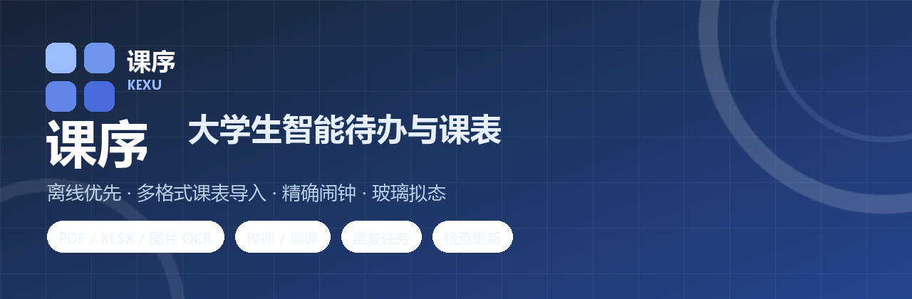
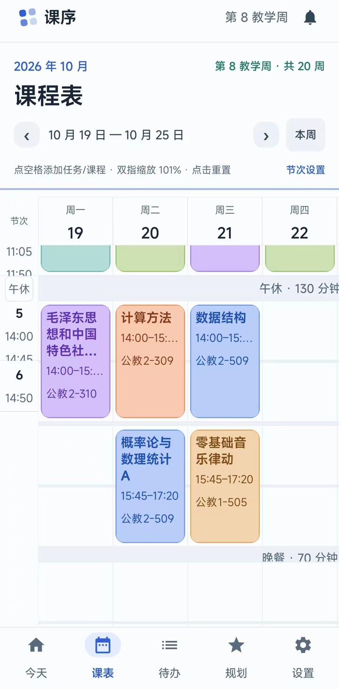
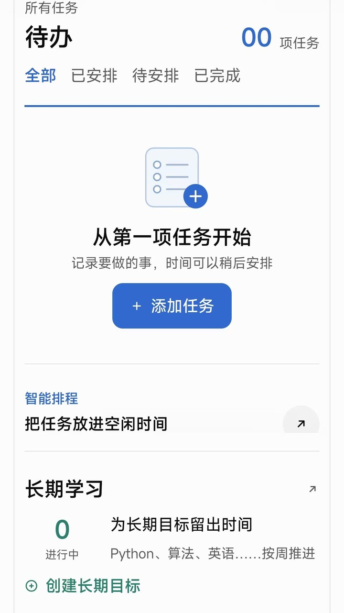
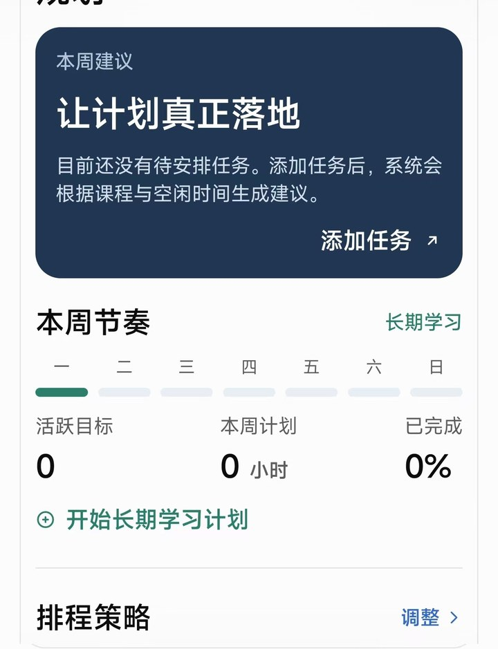
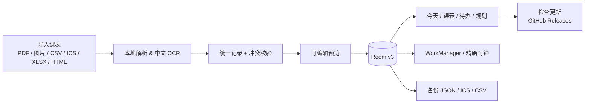

<div align="center">
  
</div>

<h1 align="center">课序 · KEXU</h1>
<p align="center"><b>离线优先的大学生课程表 / 待办 / 时间规划 App</b><br>
导入课表 → 记录任务 → 自动规划空闲时间 → 准点提醒 → 按周复盘</p>

<p align="center">
  <a href="https://github.com/juhe291/kexu-app/releases/latest">
    
  </a>
  &nbsp;
  <a href="https://github.com/juhe291/kexu-app/releases">
    
  </a>
</p>

<p align="center">
  
  
  
  
  
  
  
</p>

## 📲 快速下载

| 方式 | 链接 |
| --- | --- |
| **最新版 APK（推荐）** | [⬇️ 下载最新 APK](https://github.com/juhe291/kexu-app/releases/latest) |
| 当前版本 v1.3.2 直链 | [kexu-v1.3.2-release.apk](https://github.com/juhe291/kexu-app/releases/download/v1.3.2/kexu-v1.3.2-release.apk) |
| 全部历史版本 | [GitHub Releases](https://github.com/juhe291/kexu-app/releases) |

> Android 8.0+，包名 `com.kexu.app`。覆盖安装即可保留数据；R8 正式包使用本地调试签名，上架商店请自行配置 release 签名。

## 🖼 界面预览

<table>
<tr>
<td align="center"><br><sub>课表 · 周视图 / 双指缩放</sub></td>
<td align="center"><br><sub>待办 · 空状态 / 智能排程入口</sub></td>
<td align="center"><br><sub>规划 · 本周节奏 / 长期学习</sub></td>
</tr>
</table>

## ✨ 功能一览

| | 功能 | 说明 |
| :--: | --- | --- |
| 📥 | **多格式课表导入** | CSV / ICS / PDF（文字型 + 扫描版）/ XLSX / HTML / 图片 / JSON，本地 OCR，离线可用 |
| ✏️ | **可编辑预览** | 逐条勾选、改课程名 / 教师 / 地点 / 星期 / 节次 / 周次，实时校验冲突，确认后事务写库 |
| 📅 | **课表** | 固定日期栏、双指缩放、课程色块 / 任务虚线块、午休晚餐横带、单双周 |
| 🔁 | **停课 / 调课** | 只影响该教学周、可撤销；课表 / 今天 / 规划 / 提醒全部跟随 |
| ✅ | **待办** | 筛选排序、自选时间、每天 / 每周重复任务、长按更多操作、长期目标推进 |
| 🧠 | **智能规划** | 结合课程与空闲时间给出建议，换任务 / 换时间 / 确认加入日程 |
| ⏰ | **精确提醒** | WorkManager 兜底 + AlarmManager 精确闹钟，重启 / 改时区自动重建 |
| 💾 | **数据** | Room v3（v1→v3 迁移）、JSON 备份恢复、ICS / CSV 导出 |
| 🎨 | **外观** | 浅色 / 深色 / 跟随系统、主题色、四档字号、透明度、玻璃拟态与边缘畸变 |
| 🔄 | **检查更新** | 从 GitHub Releases 读取最新版本并引导下载（唯一联网功能） |

<details>
<summary><b>展开：导入引擎细节</b></summary>

- 格式检测 → 解析器 / 学校适配器 / 本地 OCR → 统一记录 → 校验 → 可编辑预览 → 事务写库。
- 中国地质大学（武汉）教务课表做了专用适配：星期分组 + 课程列表、跨周次合并。
- 其他学校建议用 CSV / JSON 模板交给自己的 AI 转换，或直接导入图片 / 扫描版 PDF。
- 外部 AI 模板导出：CSV / JSON / 提示词三种，JSON 模板可再导入。

</details>

## 🏗 技术架构



**技术栈**：Kotlin 1.9.25 · Jetpack Compose（BOM 2024.10.01）· Material 3 · Room 2.6.1（KSP）· DataStore · WorkManager 2.9.1 · PDFBox-Android · jsoup · ML Kit 中文 OCR（bundled，离线）

## 🚀 快速开始

### 直接安装

1. 从 [Releases 最新版](https://github.com/juhe291/kexu-app/releases/latest) 下载 APK；
2. 覆盖安装（数据保留）；
3. 首次启动允许通知权限；Android 12+ 如需准点提醒，到「设置 → 提醒与闹钟」授予精确闹钟。

### 从源码构建

```bash
cd 课序App

./gradlew :app:assembleDebug        # 调试版
./gradlew :app:testDebugUnitTest    # JVM 单元测试（203 个）
./gradlew :app:assembleRelease      # 正式版（R8，需自备签名）
```

环境：JDK 17、Android SDK Platform 35 / Build-Tools 35.0.0。`local.properties` 由本机生成，不随仓库上传。

## ✅ 测试

- **JVM 单测 203 个**：周次 / 单双周解析、PDF 版面恢复、XLSX / HTML / CSV / ICS / JSON 导入、OCR 结构恢复、导入校验、备份往返、Room 迁移、停课调课、重复任务、提醒计划、检查更新。
- **lint 0 errors**。
- 真实课表测试样例含个人信息，不在仓库提供，缺少时相关测试自动跳过；想运行可把自己的课表放到 `课序App/app/src/test/resources/`（`cug_wh_timetable.pdf` / `.xlsx` / `cug_expected.csv`）。

## 📁 项目结构

```
课序App/
├─ app/src/main/java/com/kexu/app/
│  ├─ domain/           # 周次、日期、课表结构、排程、提醒、重复任务
│  ├─ data/             # Room、DataStore、导入解析器、检查更新
│  ├─ pdf/ ocr/         # PDF 版面恢复、本地 OCR 流水线
│  ├─ ui/               # Compose 页面、组件、主题
│  └─ notify/           # WorkManager / AlarmManager 提醒
├─ app/src/test/        # JVM 单元测试
├─ app/schemas/         # Room schema 导出
└─ README.md            # 版本更新记录
```

## ❓ 常见问题

<details>
<summary><b>导入后课表有几门课对不上 / 识别不准怎么办？</b></summary>

换清晰、方向正确的课表截图；或改用 CSV / JSON 模板导入。扫描件 OCR 结果会先进入可编辑预览，确认前不会写库。

</details>

<details>
<summary><b>提醒不准点 / 收不到提醒？</b></summary>

检查「设置 → 提醒与闹钟」：普通通知开关、响铃式提醒、Android 12+ 的精确闹钟授权。未授权时用 WorkManager 兜底，可能延迟几分钟。

</details>

<details>
<summary><b>「检查更新」会联网吗？会上传数据吗？</b></summary>

只有手动点「检查更新」时请求一次 GitHub Releases API；不携带、不上传任何本地数据。其他功能完全离线。

</details>

<details>
<summary><b>为什么仓库里没有真实课表测试样例？</b></summary>

样例含姓名、学号等个人信息，出于隐私不上传；相关测试会自动跳过，可放自己的课表到 `app/src/test/resources/` 运行。

</details>

## 🔒 隐私

- 课程、任务、设置只保存在本机 Room / DataStore，不收集个人信息。
- 唯一联网功能是检查更新，只读取公开的 Releases 信息。
- 本公开仓库不含真实个人课表数据。

## ⚠️ 已知限制

- 非地大版式的文字型 PDF 走「地大适配器 → 本地 OCR 兜底」，其他学校建议 CSV / JSON 模板。
- 无限 RRULE 的 ICS 事件周次留空（按每周解释，并在预览标记待确认）。
- 课表导入暂不支持解析中途取消（一般数秒内完成）。
- R8 正式包与 debug 包同签名，可直接覆盖安装；上架应用商店需自备 release 签名。
- 桌面小组件、周报增强不在当前 1.x 规划内。

## 💬 反馈与联系

- 🐞 Bug / 功能建议：欢迎提 [GitHub Issue](https://github.com/juhe291/kexu-app/issues)
- ✉️ 邮箱：`juhe291@users.noreply.github.com`（虚拟邮箱，可转发到我的 GitHub 通知）
- ⭐ 如果觉得有用，点个 Star 支持一下
## 📜 版本与许可

- 版本更新记录见 [课序App/README.md](课序App/README.md)
- 项目暂未指定开源许可证；如需使用 / 分发请先联系作者。

<p align="center"><sub>Made with ❤️ &amp; Kotlin · 课序 KEXU</sub></p>
